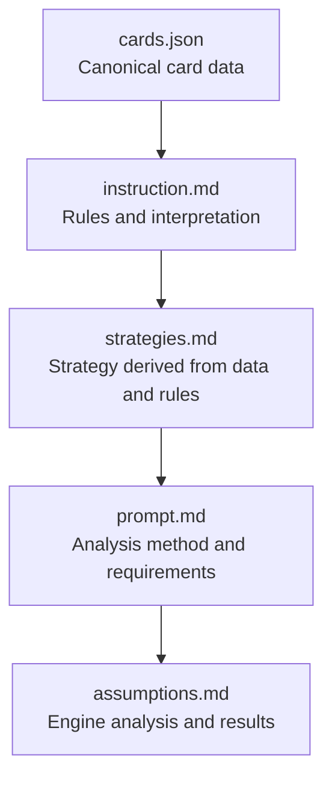

# Everdell Analysis

The goal of this project is to produce a transparent Everdell engine analysis in [`assumptions.md`](assumptions.md). The card catalog, rules summary, strategy guide, and analysis prompt are the ordered inputs needed to build and update that result. This is a research and analysis resource, not a playable game or a validated optimizer.

## Project files

| File | Purpose |
|---|---|
| [`cards.json`](cards.json) | Structured catalog of Critter and Construction cards, including costs, printed points, effects, scoring, quantities, and paired occupation cards. |
| [`instruction.md`](instruction.md) | Gameplay and setup summary, card/rule interpretation, data provenance, and required source workflow. |
| [`strategies.md`](strategies.md) | Conditional strategic guidance, engine archetypes, seasonal advice, and optimization considerations. |
| [`prompt.md`](prompt.md) | Reusable analysis prompt for estimating and comparing engines, with score-accounting safeguards and Mermaid diagrams. |
| [`assumptions.md`](assumptions.md) | The engine-analysis output: shared scenario assumptions, engine comparisons, estimates, diagrams, and recommendations. Estimates are illustrative, not authoritative facts or verified simulation results. |

## Required workflow

Follow this sequence to produce or revise the engine analysis:

Each step depends on the preceding sources: use the catalog for card facts, interpret those facts under the rules, derive strategic guidance, apply the analysis procedure, and record the resulting scenario and comparison in `assumptions.md`. This is both the required order for generating results and the precedence order for resolving conflicts. Later files must not silently override earlier card facts or rules. Preserve discrepancies, identify them, and verify gameplay interpretation against the documented official rules source.

## Card catalog

Each catalog entry describes a base-game Critter or Construction. The structured records include:

- `name`, `category`, `color`, and `rarity`
- `basePoints` and a nonzero-resource `cost` object
- `spaces` and `prerequisites`
- Structured `effects` and `endGameScoring`
- `quantity`, paired occupation card fields, and a human-readable `description`

`basePoints` is the card's printed point value; it does not include point tokens or end-game bonuses. Costs omit resources whose printed cost is zero. A `rarity` of `null` means unknown, not inferred. Paired cards indicate matching open occupation symbols, not guaranteed access to either card.

## Data sources and limitations

The card rules text and catalog values are sourced from references documented in [`instruction.md`](instruction.md), including the official Everdell rules site and third-party card catalogs used for costs, points, quantities, and rarity cross-checking.

The catalog does not include Event requirements or rewards, nor does this repository define a live game state such as a player's hand, Meadow, resources, opponents, or worker placements. Consequently:

- Engine scores and strategy rankings are conditional estimates, not expected values or proven optima.
- Do not infer deck probabilities from `quantity`: the sourced entries total 129 cards, while the rules state 128. Individual sourced quantities are retained; the total is unresolved.
- Green Production activates when played and during the applicable Spring and Autumn Production bonuses, not Summer. A card played after a Production bonus does not receive that past activation.
- Any Event values or game-state details used in examples must be identified as assumptions.

## Using the analysis prompt

Use [`prompt.md`](prompt.md) to create or update the analysis in [`assumptions.md`](assumptions.md). Compare the specified engine archetypes against a common, explicit baseline. Use an actual game state when available; otherwise, use a clearly labeled illustrative scenario and do not imply that named cards are guaranteed to appear. Show score arithmetic, resource constraints, city-space and worker costs, and distinguish gross city score from incremental engine value. Keep estimates transparent and conditional rather than presenting them as verified scores or an optimum.

## Updating the project

- Update `cards.json` first when card metadata is corrected or added.
- Keep `instruction.md` aligned with catalog semantics, sourcing, and rules interpretation.
- Reconcile strategy guidance and the analysis prompt against those higher-priority sources.
- Keep scenario assumptions explicitly labeled and revise dependent estimates when their underlying data changes.
- Validate edited JSON with a JSON parser and inspect document diffs for stale claims or whitespace errors.

There is currently no game engine, application code, automated scoring simulator, or test suite in this repository.
