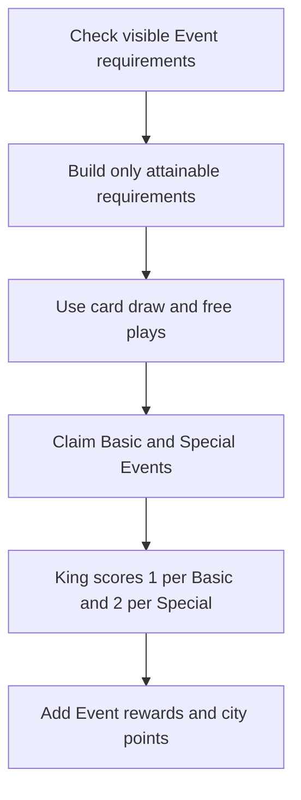
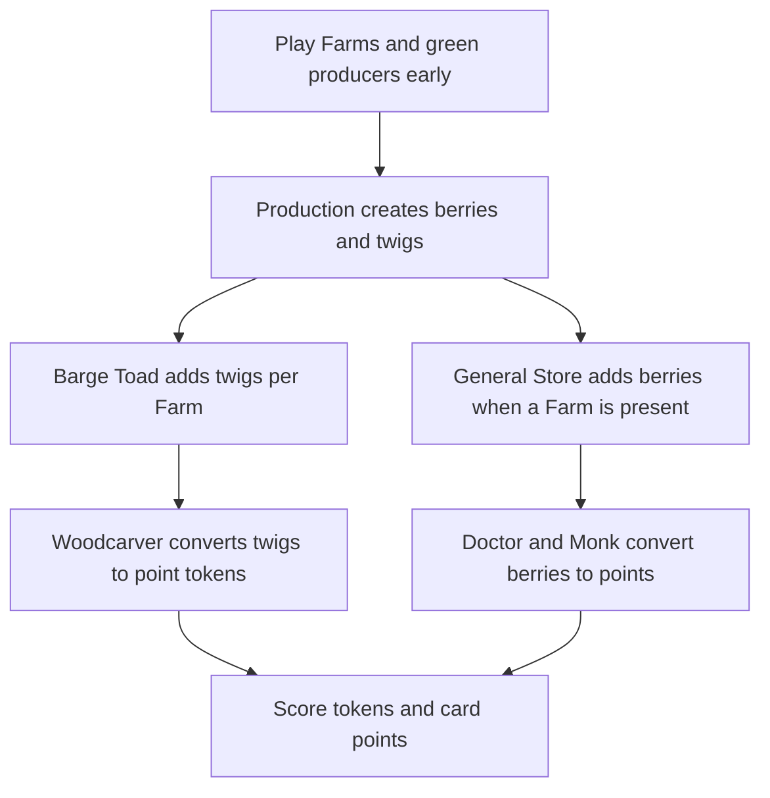
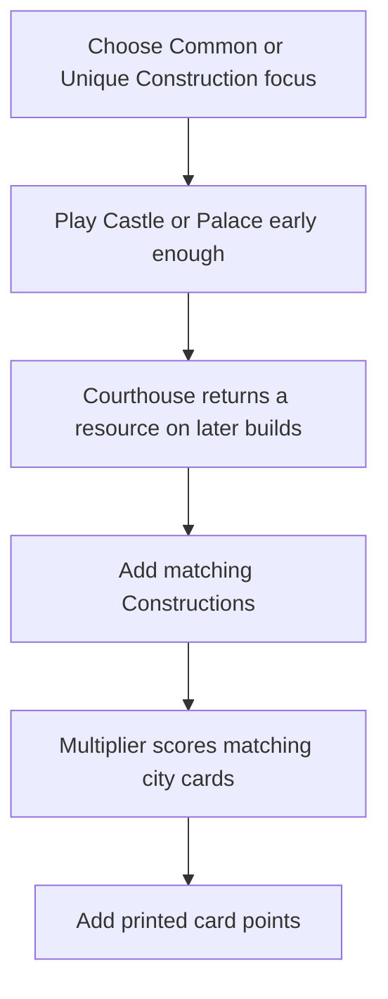
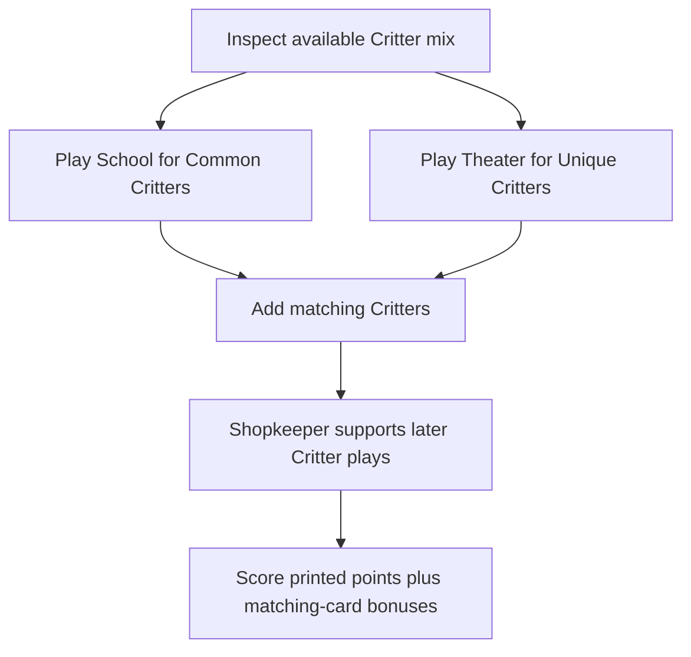
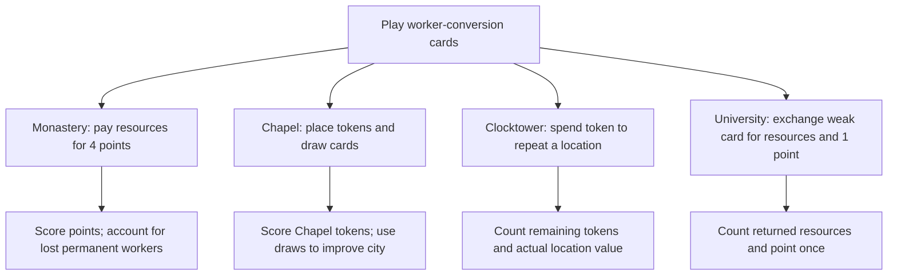
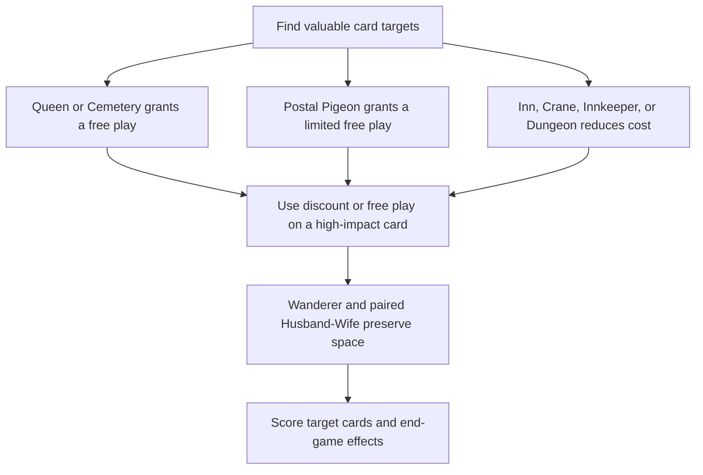
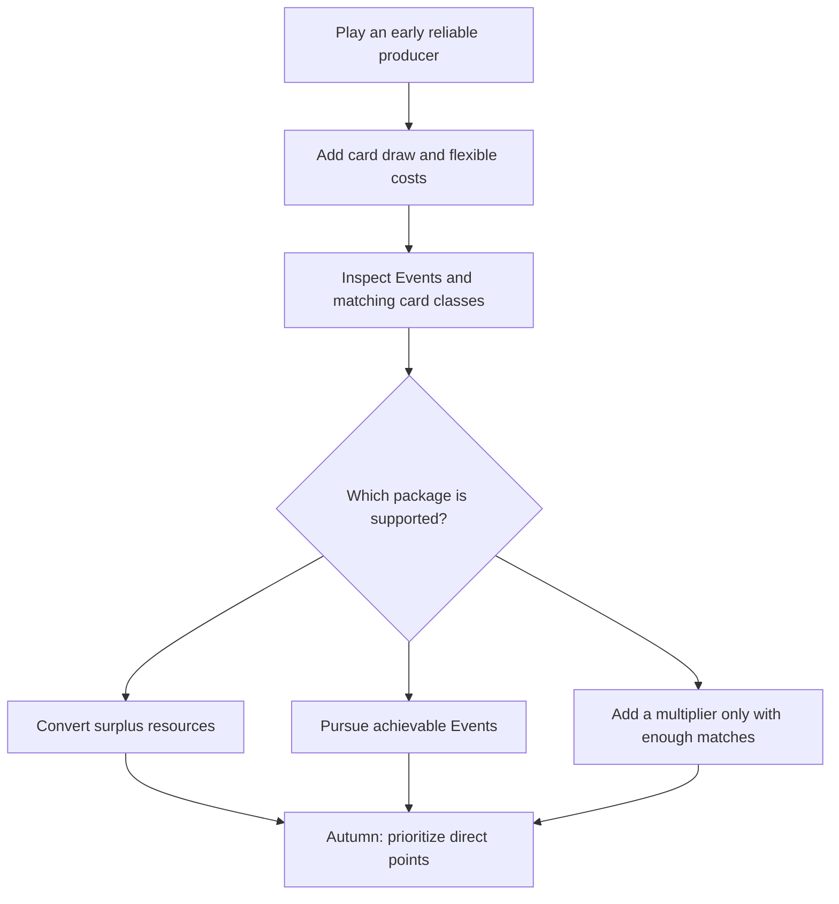

# Assumptions

This is the lowest-priority project document: it is an illustrative analysis, **not a card-data or rules authority, calculated simulation, or proven optimum**. Reconcile its claims against `cards.json` first, then `instruction.md` and `strategies.md`, using the procedure in `prompt.md`.

## Shared Illustrative Baseline

- **Game and seat:** four-player base game, first player, analysis starts at setup in Spring. The setup rules give the first player 5 cards; the initial Meadow has 8 cards.
- **Workers:** 2 workers initially, plus 4 scheduled for later seasons (1 for Spring, 1 for Summer, 2 for Autumn), for 6 potential worker placements over the full game. Deployed workers return at season preparation; workers committed permanently to cards such as Monastery or Cemetery do not. Actual actions and worker availability depend on when the player prepares.
- **City capacity:** 15 card spaces maximum. No spaces are initially occupied. Apply the Husband/Wife shared space and Wanderer exception only in scenarios that actually include those cards.
- **Resources:** the source files do not specify an initial resource inventory or a particular sequence of resource-location actions. Scenarios assume resources are acquired through legal actions or card effects; they do not prove that a full sequence is affordable.
- **Cards and Meadow:** no named card is guaranteed in the starting hand, Meadow, deck, or discard. A card package in an engine example is a conditional availability scenario, not a prediction based on deck odds.
- **Opponents and Events:** opponents do not block or take a card/location unless the scenario explicitly says so. Event requirements and rewards are not in `cards.json`; any Event results or rewards below are explicitly hypothetical. No Event completion is assumed for engines that do not mention it.
- **Production timing:** use only printed triggers and season bonuses that remain ahead in the assumed timeline. Production activates on play and at the applicable Spring/Autumn Production bonuses, not in Summer. Do not award an activation for a season already passed.

## How to Read the Estimates

The score ranges are coarse, conditional **gross city-score** illustrations, not reproducible calculations. Their endpoints are not expected values and are not a mathematically proven ceiling. Examples describe alternative cities; their packages are not meant to coexist in one city. Where exact hands, resources, Event tiles, worker-location outcomes, and turn sequences are unknown, these documents cannot establish a complete legal sequence or exact score.

`cards.json` supplies rarity, color, costs, base points, spaces, effects, and end-game scoring, but not Events or a concrete game state. Event rewards used in an estimate are hypothetical. Incremental engine value cannot be calculated numerically without a defined alternative city and equal action/resource budget; where that baseline is missing, the notes identify the engine's point-producing effects and opportunity costs without presenting gross points as net gain. The engine scenarios should be compared on the shared setup above, while any additional favorable draws or outcomes are labeled conditional. Do not infer deck odds from the supplied quantities: they total 129, while the rules state 128 cards.

## Engine analyses

### Event Control: Events and King

- **Plan:** Build toward achievable Events, then use King to add 1 point per Basic Event and 2 per Special Event achieved.
- **Core cards:** King; cards that help meet visible Event requirements.
- **Supporting cards:** Queen, Inn, Cemetery, Ranger, Wanderer, Teacher, Fair Grounds, Historian, and Ruins can help with card access or free plays.
- **Sequence and timing:** In Spring, inspect requirements and build only toward attainable Events. In Summer, use card access and free plays to finish the city requirements. King can be played before or after the Events; its cataloged bonus scores at game end based on Events achieved. In Autumn, claim available Events rather than adding pieces for Events you can no longer reach.
- **Resources, spaces, workers, and actions:** `cards.json` lists King at 6 berries and 4 printed points; it occupies a city space. Event claims use workers and may be contested. The engine competes with direct scoring for cards, resources, and actions.
- **Score estimate:** Illustrative scenario: 2 Basic and 1 Special Event achieved.
  - Printed points: King’s 4 plus about 6–14 from other city cards = **10–18**.
  - King bonus: 2 Basic + 1 Special = **4**.
  - Event rewards: assume **8–15 total** for the three Events; the values aren’t in the supplied data.
  - Other points: assume **0–4** from tokens or other effects.
  - **Plausible gross total: about 22–41 points.** Conditional high end: **about 46–58**, assuming 2 Basic and 2 Special Events are achieved, Event rewards total 12–20 points (hypothetical), the city contributes 28–30 points including King, and other tokens contribute 0–2: **28–30 + 6 King bonus + 12–20 Event rewards + 0–2 = 46–58**. This is not an expected result; four Event claims consume four worker placements and depend on requirements and rewards absent from the catalog.
  - Incremental engine value is the Events’ rewards plus King’s bonus, minus the resources and actions spent satisfying the Events rather than taking other scoring actions.
- **Risks and pivot:** Events may be unavailable, too costly to pursue, or taken by opponents. If the required cards aren’t coming by late Summer, stop building around King and favor direct points or a different engine.

### Production Conversion: Farms and point tokens

- **Plan:** Use early Production cards to create resources, then convert surplus berries and twigs to point tokens.
- **Core cards:** Farm, General Store, Doctor, Woodcarver, and Monk.
- **Supporting cards:** Barge Toad can produce twigs for each Farm; Chip Sweep can reactivate a green card. Husband paired with Wife shares a space and can produce a flexible resource if there’s a Farm.
- **Sequence and timing:** Play one or two green producers before a remaining Production activation to benefit from it. If played before Spring Production, a card can activate on play, in Spring, and again in Autumn; after Spring Production it can activate on play and in Autumn. Summer provides card draws, not a green Production activation. Add converters when the resource flow supports them and convert what you can afford before passing.
- **Resources, spaces, workers, and actions:** A Doctor or Woodcarver can convert up to three resources into points per permitted activation; Monk can convert berries at a higher rate but gives them to an opponent. Resource production, conversion opportunities, and city spaces all limit the return. Don’t count the same berry as spent by multiple converters.
- **Score estimate:** Example package of two Farms, General Store, Barge Toad, Doctor, Woodcarver, and Monk uses 7 spaces.
  - Printed points for that package: **10**. Add 5–8 other city cards at an assumed 8–16 printed points.
  - Resource ledger for the seven engine cards: **5 twigs, 2 resin, 1 pebble, and 9 berries** to play. If both Farms, General Store, and Barge Toad each get three permitted triggers (on play, Spring, Autumn), they produce **6 berries from Farms, up to 6 from General Store, and 12 twigs from Barge Toad**. After the listed cards' costs, that leaves at most 3 berries and 7 twigs before other resource actions. Converting these leftovers yields at most **6 points from Monk** (if an opponent can receive the berries) plus **7 from Woodcarver**; Doctor has no berries left in this card-only ledger. This is an illustrative upper bound, not a verified turn-by-turn sequence.
  - Allow **8–13** point tokens when extra worker-location resources or a less costly alternative package enables the conversions; the upper endpoint requires additional resources beyond this ledger.
  - **Plausible gross total: about 26–39 points** (10 + 8–16 printed card points + 8–13 tokens). Conditional high end for this package: **about 39**, requiring early Production, the added city cards, and enough actions/resources to realize the assumed conversion.
  - Incremental engine value is the tokens and useful resource surplus, less the cost of the engine cards and the actions spent building it instead of scoring directly.
- **Risks and pivot:** The engine underperforms if built too late or if it produces resources the city can’t convert. If the producers won’t activate enough to pay back their costs, take direct points, use a free play, or pursue a visible Event.

### Construction Multipliers: Castle and Palace

- **Plan:** Choose common or unique Constructions based on what is available, then score them with Castle or Palace. Courthouse can return a resource when later Constructions are played.
- **Core cards:** Castle and/or Palace, plus matching Constructions.
- **Supporting cards:** Courthouse helps when several Constructions remain to be played.
- **Sequence and timing:** In Spring, gather resources and identify which class of Constructions is realistically available. In Summer, play a multiplier while there is still room for the cards it scores. In Autumn, fill remaining spaces with matching Constructions only if their bonus exceeds the value of alternatives.
- **Resources, spaces, and actions:** Castle and Palace are expensive and each occupies a space. A multiplier without enough matching cards may score less than a direct-points card. Courthouse returns a resource for later Constructions, not for itself.
- **Score estimate:** Illustrative package: Castle, Palace, four Common Constructions, and three Unique Constructions.
  - Printed points for the nine-card package: roughly **16–24**, depending on the selected Constructions. Castle and Palace together cost **4 twigs, 6 resin, and 6 pebbles**; resource access for the other cards is unspecified.
  - Castle bonus: **4** for the four Common Constructions. Palace bonus: **4** for itself and the three other Unique Constructions.
  - Add 3–5 other city cards: **about 5–10** printed points.
  - **Plausible gross total: about 29–42 points** (16–24 + 8 multiplier points + 5–10). Conditional high end: **about 45–52**, for a fuller city with approximately 31–38 printed points and 14 matching-card bonus points; no Events are included.
  - Incremental engine value is the multiplier bonus plus any Courthouse resources, less the multiplier’s cost and the value of the spaces used by the package.
- **Risks and pivot:** Don’t pursue both multipliers automatically. If the available cards don’t give enough matching Constructions, build around only one or pivot to Critter scoring or direct points.

### Critter Multipliers: School and Theater

- **Plan:** Build a Critter-heavy city and choose School, Theater, or both only when matching Critters are available.
- **Core cards:** School scores Common Critters; Theater scores Unique Critters.
- **Supporting cards:** Shopkeeper can return a berry after later Critters are played. Husband and Wife share one space; Wanderer draws cards without taking a space.
- **Sequence and timing:** In Spring, improve card access and watch for a Common or Unique Critter concentration. In Summer, play the multiplier before its matching Critters, if possible. In Autumn, prefer matching Critters with points or useful abilities over filler.
- **Resources, spaces, and actions:** Both multipliers take spaces and require the right Critter mix. The multiplier counts are hypothetical assumptions about which cards are in the city, even though Common/Unique rarity is now recorded in the catalog. Shopkeeper’s benefit depends on having further Critters to play. Husband and Wife share one space, but still require both cards and their costs.
- **Score estimate:** Example city with School, Theater, and seven matching Critters (3 Common and 4 Unique), including a paired Husband and Wife. The pair uses one space, so this package takes 8 city spaces.
  - Printed points: roughly **20–30**, depending on the selected Critters and multipliers.
  - Multiplier bonus: **3 School points + 4 Theater points = 7**.
  - Add any tokens or Events only if actually earned; not included in this example.
  - **Plausible gross total: about 27–37 points** (20–30 printed + 7 multiplier points). Conditional high end: **about 45–55** if a near-full city contributes 38–47 printed points and at least 7 multiplier points. No tokens or Events are included in either calculation.
  - Incremental engine value is the matching-card bonus and any Shopkeeper berries, less the multiplier card’s cost and the opportunity cost of filling spaces with the required Critter classes.
- **Risks and pivot:** A mixed city may not support either multiplier enough. Count likely eligible Critters and remaining spaces before committing; pivot to whichever class is already strongest.

### Worker Conversion: Monastery, Chapel, Clocktower, and University

- **Plan:** Turn worker placements into direct points, card access, or a repeat of a useful location.
- **Core cards:** Monastery, Chapel, Clocktower, and University.
- **Supporting cards:** Monk unlocks Monastery’s second room; Shepherd can gain point tokens equal to those already on Chapel.
- **Sequence and timing:** In Spring, Chapel can provide card draw early enough to influence later plays. In Summer and Autumn, use Clocktower where it repeats a valuable occupied Basic or Forest location. Consider University when exchanging a weak city card is worthwhile. Use Monastery only if the permanent worker cost is acceptable.
- **Resources, spaces, and actions:** Monastery costs two resources per visit for four points, but its worker stays permanently. Chapel’s token count also determines card draw. Clocktower starts with three tokens; returning a token to activate a location sacrifices that token’s point. University returns the discarded card’s cost, one resource, and one point, but requires a card to discard.
- **Score estimate:** Example package includes these cards and Monk or Shepherd support.
  - Printed points: roughly **5–9** for the package and support.
  - Monastery: **4–8** points for one or two visits, if affordable.
  - Chapel: assume **2–4 tokens** placed = **2–4 points**; card draw is utility, not additional points by itself.
  - Clocktower: **0–3 points** left on the card, plus only the actual value of repeated locations.
  - University: assume **1–3 points** from visits; count returned resources as resources, not points.
  - Add other city cards: **about 6–12** printed points.
  - **Plausible gross total: about 18–39 points.** Conditional high end: **about 40–45** with valuable repeated locations and several scoring visits.
  - Monastery’s gross points overstate its net value: subtract the value of actions lost when workers are permanently committed. A rough illustrative net range is **about 14–34**, depending on what those workers could otherwise have done.
- **Risks and pivot:** Permanent workers can cost more than the points they earn. If the board lacks valuable repeatable locations, or workers are needed for Events and resources, prioritize flexible actions instead.

### Free-Play and Space Efficiency

- **Plan:** Use discounts, free plays, and cards that save space to acquire valuable effects while preserving resources and city capacity.
- **Core cards:** Queen, Inn, Cemetery, Postal Pigeon, Crane, Innkeeper, and Dungeon.
- **Supporting cards:** Wanderer avoids using a city space; Husband and Wife share one. Draw effects help find stronger free-play targets.
- **Sequence and timing:** In Spring, prioritize card access and set up free-play opportunities. In Summer, use discounts on cards that are otherwise expensive and free plays on high-impact targets. In Autumn, stop investing in setup cards unless they still return value; fill remaining spaces with scoring cards.
- **Resources, spaces, and actions:** Queen plays a card worth up to 3 base points for free when visited. Inn discounts a Meadow card by three resources. Cemetery provides a free play but commits its worker permanently. Postal Pigeon can play a revealed card worth up to 3 points for free. Crane and Innkeeper provide discounts by discarding themselves. Dungeon discounts a later card but removes the imprisoned Critter from normal scoring. These are resource savings, not points until they enable a better card or action.
- **Score estimate:** Example city includes several tools plus targets actually played with the resulting free plays.
  - Printed points from the engine cards: roughly **8–14**.
  - Two free-play targets: assume **4–6** printed points combined.
  - Add 4–6 other cards: **about 8–14** printed points.
  - Discounts themselves add **0 direct points**; assume **0–6** extra points only where they enable a better target than the alternative.
  - **Plausible gross total: about 20–40 points.** Conditional high end: **about 45–52** if multiple free plays hit valuable cards and Wanderer/Husband-Wife save space.
  - Incremental value is the difference between the free-play target and the card or action you would otherwise have used, not the nominal three-resource discount.
- **Risks and pivot:** A free play spent on a low-impact card may not repay the setup. Don’t count the same free-play card twice, and account for Crane/Innkeeper being discarded and Dungeon’s sacrificed Critter.

### Flexible Fallback Engine

- **Plan:** Build one dependable source of resources or cards, use flexible costs and draw to keep options open, then switch to direct points and achievable Events.
- **Core cards:** One or two early green producers; card-access pieces such as Wanderer, Teacher, Fair Grounds, Historian, or Ruins.
- **Supporting cards:** Judge, Peddler, Inn, Queen, and whichever direct-point or conversion cards appear.
- **Sequence and timing:** In Spring, play early production and card access. In Summer, commit to the strongest package visible—Events, a multiplier, or resource conversion. In Autumn, stop adding weak engine pieces and convert remaining resources or workers into points.
- **Resources, spaces, and actions:** This plan avoids requiring one exact set of cards, but must still respect the 15-space city limit and seasonal worker supply. Its flexibility comes from retaining options, not from a single high-scoring combo.
- **Score estimate:** Illustrative city: roughly 5–8 engine cards plus 5–7 scoring or support cards.
  - Printed card points: assume **15–27** across the city.
  - Tokens from modest conversion: **about 3–8**.
  - Event points: assume **0–8**, depending on what is achievable.
  - **Plausible gross total: about 18–43 points** (15–27 printed + 3–8 tokens + 0–8 hypothetical Event points). Conditional high end: **about 42–48** if the flexible plan pivots into a supported multiplier or Event package; the Event contribution must be supported by actual requirements and rewards.
  - Incremental value is the engine’s surplus conversion and draw-enabled improvement over a city of similar size built without synergy; that cannot be computed from the supplied files.
- **Risks and pivot:** A plan that stays flexible too long can become a collection of unrelated cards. Choose the strongest visible direction by Summer and stop adding production that won’t activate enough to repay its cost.

## Comparison

| Engine | Plausible points | Conditional high end | Reliability | Main cost or risk |
|---|---:|---:|---|---|
| Event Control | 22–41 | 46–58 | Low–medium | Event requirements and competition |
| Production Conversion | 26–39 | 39 | Medium | Needs early production and conversion resources |
| Construction Multipliers | 29–42 | 45–52 | Low–medium | Needs a concentrated Construction mix |
| Critter Multipliers | 27–37 | 45–55 | Low–medium | Needs matching Critters and city space |
| Worker Conversion | 18–39 gross; 14–34 illustrative net | 40–45 gross | Medium | Permanent worker and action opportunity costs |
| Free-Play and Space Efficiency | 20–40 | 45–52 | Medium | Value depends on finding good targets |
| Flexible Fallback | 18–43 | 42–48 | Medium–high | Lower ceiling if it never commits to a package |

Reliability here is a qualitative estimate of how likely an engine is to remain useful when specific cards, Events, resources, or worker locations aren’t available. It is not derived from deck odds, since quantities are disputed and the game state is unknown. The flexible fallback is most robust because it can pivot; its score is not guaranteed to be higher. Scores and rankings are provisional until rebuilt from a specified game state, sourced card values, and verified Event data.

## Recommendation

- **Highest conditional ceiling:** Event Control in these illustrations, if the assumed Events are both achievable and valuable. Production Conversion can be strong, but the card-only resource ledger caps the example's conversion at 13 tokens; additional worker-generated resources would need to be modeled to raise that ceiling.
- **Most reliable:** Flexible Fallback, provided it pivots to a concrete scoring package by Summer rather than building unrelated cards.
- **Best without a supplied game state:** Start with early production and card access, then commit by Summer. Favor Production Conversion when the resource and conversion cards appear; pivot to a multiplier only when enough matching cards are visible, or to Event Control when several requirements are already achievable.