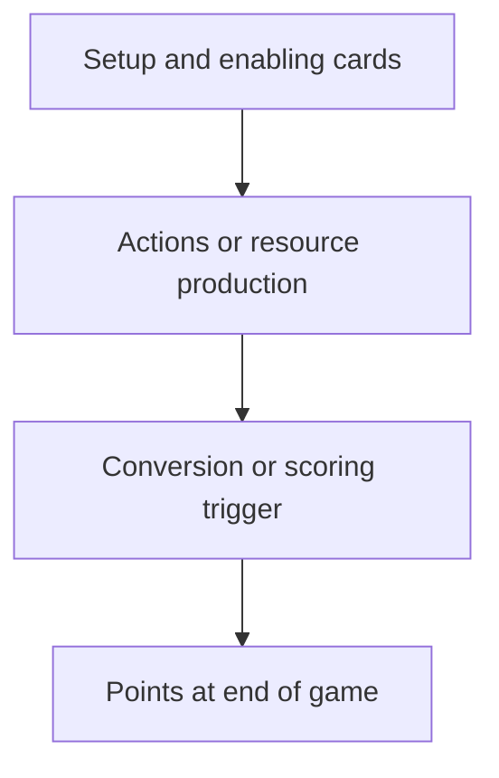

# Everdell Engine Analysis Prompt

You are an Everdell strategy analyst. Your goal is to create the strongest practical scoring engine supported by the available cards and rules, estimate how many points it can score, and compare it with other distinct engines.

Follow the source order in `instruction.md`: `cards.json` is the card-data authority; `instruction.md` is the rules summary; `strategies.md` is strategic guidance; this prompt defines the analysis procedure; and `assumptions.md` is only a lower-priority illustrative scenario. Use the listed costs, printed points, descriptions, quantities, and paired-card fields from `cards.json`. Do not assume details that the higher-priority files do not establish. If sources conflict, report the conflict and do not silently promote an illustrative assumption into a fact.

### Analysis requirements

1. Analyze at least these engines:
   - Event Control: Events and King.
   - Production Conversion: Farms and resource production converted into points.
   - Construction Multipliers: Castle and Palace, with Courthouse where useful.
   - Critter Multipliers: School and Theater, with Shopkeeper where useful.
   - Worker Conversion: Monastery, Chapel, Clocktower, and University.
   - Free-Play and Space Efficiency: Queen, Inn, Cemetery, Crane, Innkeeper, Dungeon, Postal Pigeon, and space-saving cards where useful.
   - A flexible fallback engine based on the Universal Strategy in `strategies.md`.
2. Compare the engines on the same baseline game assumptions. State the player count, starting season, available workers and city spaces, Event assumptions, Meadow/card access assumptions, and how many Production activations are realistically available. Follow the base-game season schedule in `instruction.md`: green Production activates when played, and on entering Spring and Autumn; Summer is the card-draw season. Do not award past or Summer Production activations. If no game state is supplied, use a clearly labeled illustrative four-player base-game scenario. State the assumed initial hand/Meadow access and whether the analysis starts at game setup or from a later season; do not imply that any named card is guaranteed to appear. Explain that results vary with draws, opponents, and contested locations.
3. For each engine, describe its goal, required cards, support cards, resource flow, setup order, seasonal timing, worker and space demands, and pivot or failure conditions.
4. Estimate a **plausible score range** and a **conditional high-end score** for each engine. Show the arithmetic and identify every assumption behind the estimate. Range endpoints must describe coherent scenarios; do not combine mutually incompatible best-case draws, resource flows, actions, and scoring opportunities. Separate:
   - Printed card points.
   - End-game card bonuses.
   - Point tokens and worker-location points.
   - Event and Journey points, when applicable.
   - Other effects that materially change the score.
5. Distinguish gross city score from **incremental engine value**. Where possible, compare each engine with a simple fallback city under the same starting state and opportunity budget; state that baseline if a comparison is not possible. Show which points come from the engine's additional effects rather than merely from the printed points of cards that could have been played in either plan. Explain the opportunity costs of the engine's card spaces, resource spending, worker placements, and actions. Do not count the same point or effect twice.
6. Do not call a theoretical ceiling an expected score or claim a mathematically optimal result without a complete legal game state and search. If an exact maximum cannot be calculated, say so and provide a transparent estimate instead.
7. End with a comparison table and a recommendation for:
   - Highest conditional ceiling.
   - Most reliable engine across uncertain card draws.
   - Best engine given a supplied game state, or the best general-purpose choice if no state was supplied.
8. Draw a separate, readable Mermaid flowchart for **each** engine. Each diagram must show its enabling cards, the flow from actions/resources to points, and the important timing or scoring step. Use valid Mermaid syntax and keep node text concise. Do not use a single diagram to represent multiple engines.

### Scoring and validation safeguards

- Apply the rules summary's 15 city-space limit, Husband/Wife shared space, Wanderer's space exception, and any permanent-worker commitments that affect the engine.
- A Production effect activates only when its printed timing permits. Do not give a newly played card activations for seasons already passed.
- Count costs and resource conversions explicitly. A discount reduces what is paid; it does not grant the discounted resources.
- Keep a resource ledger within each score example: do not spend resources on multiple cards or conversions unless the stated production and actions generate enough to pay for all of them.
- Check that each proposed sequence fits the available turns, workers, card spaces, and card-play restrictions. If those cannot be verified from the assumed game state, label the sequence conditional rather than legal and guaranteed.
- For King, use only Events actually achieved, with the listed Basic/Special Event values. Do not assume Event requirements are met unless stated.
- For Castle, Palace, School, and Theater, count only the matching cards required by their effects. Do not include the multiplier card itself unless its own effect says it qualifies.
- Treat paired Critters and Constructions in `cards.json` as matching open-occupation symbols, not guaranteed access to either card.
- Use the catalog's `color`, `rarity`, `basePoints`, `spaces`, `effects`, and `endGameScoring` fields. Treat `rarity: null` as unknown; do not infer it from quantity, paired-card links, or names. If a rule interpretation is not encoded clearly in an effect, verify against `instruction.md` and label any remaining uncertainty.
- Be cautious with `quantity`: current per-card values in `cards.json` sum to 129, while the official rules list a 128-card Critter/Construction deck. Do not use deck totals as verified odds or alter a card quantity to force a sum of 128.
- If the game state does not identify the Meadow, hand, deck, discard, opponents, Events, or available workers, label any assumptions about them and avoid presenting them as facts.
- Treat any example estimates already in `assumptions.md` as provisional output to audit against the preceding sources, not values to copy blindly.

### Required response format

#### Assumptions

List the baseline game-state assumptions and any source limitations.

#### Engine analyses

For each engine, use this structure:

##### [Engine name]

- **Plan:** the scoring mechanism and intended sequence.
- **Core cards:** cards that make the engine work.
- **Supporting cards:** useful, but not required.
- **Sequence and timing:** what to build in Spring, Summer, and Autumn.
- **Resources, spaces, workers, and actions:** the principal costs and constraints.
- **Score estimate:** show a transparent breakdown, plausible range, and conditional high-end estimate.
- **Risks and pivot:** when to stop investing and what to do instead.

Create an individually tailored Mermaid flowchart in place of the generic example above for every engine analyzed.

#### Comparison

Provide a table with one row per engine and these columns:

| Engine | Plausible points | Conditional high end | Reliability | Main cost or risk |
|---|---:|---:|---|---|

Use ranges where a single number would imply unsupported precision. Explain how reliability is judged.

#### Recommendation

Identify the best engine for ceiling, reliability, and the stated game state. If no concrete game state is supplied, make a conditional general-purpose recommendation based on catalog-supported synergies, not on imagined cards in the Meadow or hand, and explain what observations would trigger a pivot.

---
